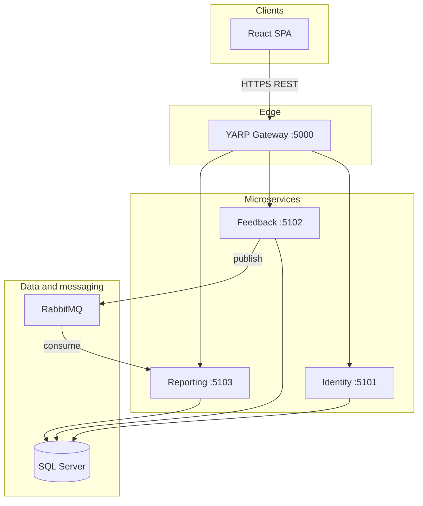
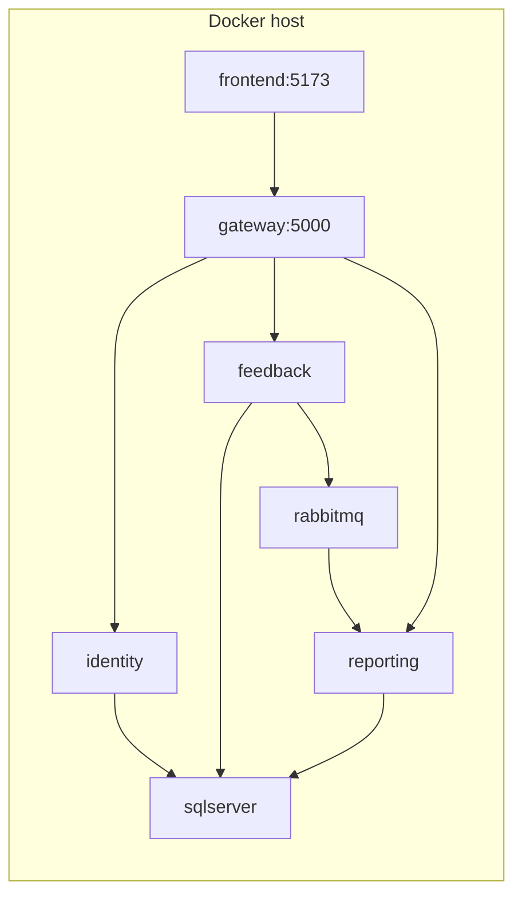
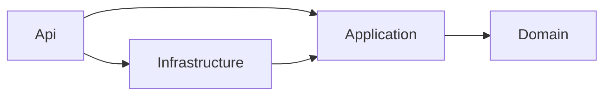
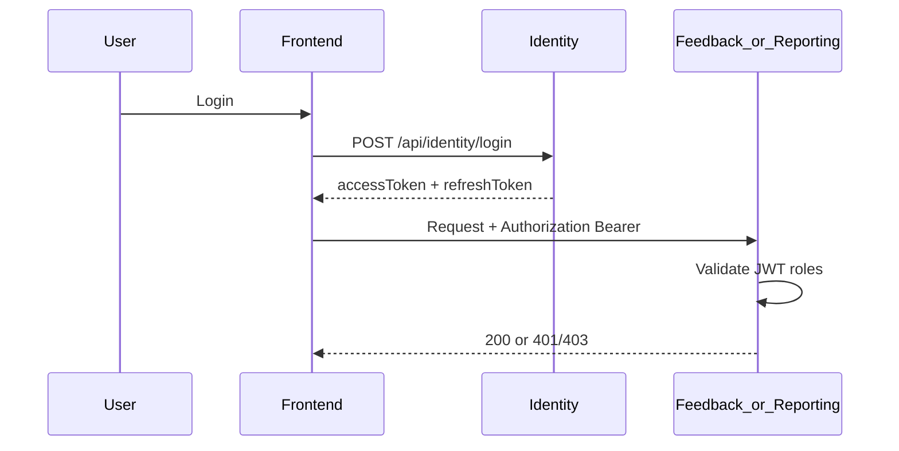

# System Architecture — Customer Feedback

This document describes the **as-built v1 architecture** for the Customer Feedback platform: a store-manager solution to collect customer feedback, categorize it, and surface satisfaction trends.

Related documents:

- [High Level Design (HLD)](hld.md)
- [Low Level Design (LLD)](lld.md)
- [Parallel development plan](../plan.md)
- Business requirements: [feedback form.docx](feedback%20form.docx)

## Architectural goals

| Goal | Approach |
| --- | --- |
| Independent FE/BE delivery | Contract-first OpenAPI + event schemas in [`contracts/`](../contracts/); frontend uses MSW until the gateway is available |
| Loose coupling | Four deployable backend components behind one API entry point |
| Write/read separation | Feedback owns submissions; Reporting maintains a projection fed by RabbitMQ |
| Security | JWT bearer + role-based access (`Customer`, `StoreManager`) |
| Operability | Structured Serilog JSON, health endpoints, docker-compose for local full stack |

## Logical architecture



## Component responsibilities

| Component | Responsibility | Sync API prefix | Owns data |
| --- | --- | --- | --- |
| **Gateway** | Single public URL, CORS, route to services | `/api/*` | None |
| **Identity** | Registration (customers), login, refresh, profile; seed store manager | `/api/identity` | `CF_Identity` (users, roles, refresh tokens) |
| **Feedback** | Submit feedback, customer “mine” list, manager list/filter, category/status updates | `/api/feedback` | `CF_Feedback` |
| **Reporting** | Manager dashboard KPIs from read model | `/api/reports` | `CF_Reporting` (projection) |
| **Frontend** | SPA, RTK Query, optional MSW mocks | Via gateway or mocks | None (browser storage for refresh token v1) |

## Communication styles

| From | To | Style | Purpose |
| --- | --- | --- | --- |
| Browser | Gateway | REST (JSON) | All user operations |
| Gateway | Services | HTTP reverse proxy | Path-based routing |
| Feedback | RabbitMQ | Async messages (MassTransit) | `FeedbackSubmitted`, `FeedbackUpdated` |
| RabbitMQ | Reporting | Async consume | Update `FeedbackFact` projection |

No synchronous calls from Reporting to Feedback (CQRS-style read model).

## Deployment views

### Local development (split processes)

| Process | URL | Notes |
| --- | --- | --- |
| Frontend (Vite) | `http://localhost:5173` | `VITE_USE_MSW=true` → no backend required |
| Gateway | `http://localhost:5000` | Proxy target for Vite `/api` |
| Identity | `http://localhost:5101` | Direct access for debugging |
| Feedback | `http://localhost:5102` | Publishes to RabbitMQ when not in-memory |
| Reporting | `http://localhost:5103` | Consumes from RabbitMQ |
| SQL Server | `localhost:1433` | Three logical databases |
| RabbitMQ | `localhost:5672` | Management UI `15672` |

### Docker Compose

[`docker-compose.yml`](../docker-compose.yml) builds and wires the same topology: `sqlserver`, `rabbitmq`, `identity`, `feedback`, `reporting`, `gateway`, `frontend`. Environment variables are documented in [`.env.example`](../.env.example).



## Cross-cutting concerns

| Concern | Implementation |
| --- | --- |
| Authentication | JWT issued by Identity; validated on each API (`CustomerFeedback.BuildingBlocks`) |
| Authorization | ASP.NET Core policies per role on Feedback and Reporting endpoints |
| Errors | RFC 7807 Problem Details via shared exception middleware |
| Logging | Serilog compact JSON; `traceId` on errors |
| Validation | FluentValidation (server); form rules aligned on client |
| Configuration | `appsettings` + environment variables + user-secrets; secrets not in git |

## Repository layout (monorepo)

```
contracts/          # OpenAPI, events, errors — source of truth for parallel teams
frontend/           # React 19 + Vite + RTK Query + MSW
backend/
  gateway/          # YARP
  services/         # identity, feedback, reporting
                    # each service: Domain, Application, Infrastructure, Api, Api.Tests
  shared/           # CustomerFeedback.BuildingBlocks
docker-compose.yml
plan.md             # Delivery and milestone plan (not duplicated here)
Docs/               # HLD, LLD, architecture, business doc
```

## Clean Architecture inside each service

Identity, Feedback, and Reporting each use four projects. Dependencies point inward.



| Project | Owns | Must not reference |
| --- | --- | --- |
| `*.Domain` | Entities and rules (`FeedbackEntry.ChangeCategory`, role names) | EF Core, ASP.NET, MassTransit, BuildingBlocks |
| `*.Application` | Use-case handlers, request and response contracts, ports (`IFeedbackRepository`, `ITokenIssuer`) | EF Core, MassTransit, HTTP |
| `*.Infrastructure` | EF Core, MassTransit adapters, ASP.NET Identity | The Api project |
| `*.Api` | Composition root, authorization, minimal API routes | Domain rules and SQL |

Application may use `CustomerFeedback.BuildingBlocks` for Problem Details, paging, and integration events. `ApplicationUser` stays in Identity infrastructure because it extends ASP.NET Identity’s `IdentityUser<Guid>`. Handlers are plain dependency-injection classes. HTTP routes, status codes, and JSON shapes are unchanged.

## Security architecture (v1)



- **Customers** self-register; **store managers** are seeded at startup (not public signup).
- v1 stores refresh token in `localStorage` (documented temporary; httpOnly cookies are post-v1).

## Scalability and evolution (out of v1 scope)

- Horizontal scale: stateless APIs + gateway; Reporting read model supports read-heavy dashboard.
- Future: dedicated invite flow for managers, multi-store org hierarchy, outbox pattern for guaranteed event delivery, centralized API JWT validation at gateway, Kubernetes/Azure hosting.

## References

| Artifact | Location |
| --- | --- |
| Identity API contract | [`contracts/openapi/identity.v1.yaml`](../contracts/openapi/identity.v1.yaml) |
| Feedback API contract | [`contracts/openapi/feedback.v1.yaml`](../contracts/openapi/feedback.v1.yaml) |
| Reporting API contract | [`contracts/openapi/reporting.v1.yaml`](../contracts/openapi/reporting.v1.yaml) |
| Events | [`contracts/events/`](../contracts/events/) |
