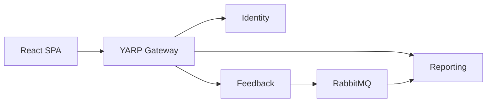

# Customer Feedback — Presenter Slides (outline)

Use this as a slide deck script. One `---` block ≈ one slide. Export to PowerPoint/Google Slides by copying section titles and bullets.

Full demo steps: [demo.md](../demo.md) · Cheat sheet: [demo-one-pager.md](../demo-one-pager.md)

---

## Slide 1 — Title

**Customer Feedback Platform**  
Store satisfaction collection & manager analytics

React 19 · .NET 10 · Microservices · RabbitMQ

---

## Slide 2 — Problem

- Stores need **structured** feedback, not ad-hoc comments
- Managers need **trends** and **actionable** queues
- Customers need a **simple** post-visit channel

---

## Slide 3 — Who uses it

| **Customer** | **Store manager** |
| --- | --- |
| Register & login | Seeded account (no public signup) |
| Submit feedback | Dashboard KPIs |
| View own history | Filter, recategorize, change status |

---

## Slide 4 — Live demo plan (5–10 min)

1. Register customer → submit feedback  
2. Switch to manager → dashboard  
3. Triage one item (status / category)  
4. Show dashboard again  

*Tip: Run `.\scripts\start-backend.ps1` then `.\scripts\start-frontend.ps1` (see [demo.md](../demo.md)).*

---

## Slide 5 — Customer journey (screen)

**Routes:** `/register` → `/login` → `/feedback/new` → `/feedback/mine`

**Form highlights:**

- 1–5 ratings (overall, cleanliness, staff, wait, products)
- NPS 0–10
- Category: Service / Product / Facilities / Other
- Optional anonymous submission

---

## Slide 6 — Manager journey (screen)

**Routes:** `/` (dashboard) · `/manager/feedback`

**Dashboard:**

- Total count, avg overall, avg NPS
- By category · trend · New / Reviewed / Actioned

**Actions:** PATCH category · PATCH status

---

## Slide 7 — Architecture (high level)

**Sync:** REST through gateway  
**Async:** Feedback events → Reporting read model

---

## Slide 8 — Services & data

| Service | Database | Responsibility |
| --- | --- | --- |
| Identity | CF_Identity | Users, JWT, refresh tokens |
| Feedback | CF_Feedback | Submissions, manager edits |
| Reporting | CF_Reporting | Projection for KPIs |

Database-per-service · No cross-DB queries

---

## Slide 9 — Contract-first delivery

- OpenAPI in `contracts/openapi/`
- Event schemas in `contracts/events/`
- Frontend: **RTK Query** → gateway via Vite proxy (`VITE_USE_MSW=false`)

Enables **parallel** FE/BE teams

---

## Slide 10 — Security (v1)

- JWT bearer · roles: `Customer`, `StoreManager`
- Problem Details (RFC 7807) on errors
- FluentValidation + comment sanitization
- Secrets via env / user-secrets (not in git)

---

## Slide 11 — Demo credentials

**Manager (live):** `manager@store.local` / `ChangeMe!123`  
**Customer:** register in app

Gateway: `http://localhost:5000` · UI: `http://localhost:5173` · scripts: `scripts/start-*.ps1`

---

## Slide 12 — Q&A / deeper docs

| Topic | Document |
| --- | --- |
| Architecture | [Docs/architecture.md](architecture.md) |
| HLD / LLD | [Docs/hld.md](hld.md) · [Docs/lld.md](lld.md) |
| API contracts | `contracts/openapi/` |
| Runbook | [demo.md](../demo.md) |

**Tests:** `dotnet test backend/CustomerFeedback.slnx`

---

## Slide 13 — Thank you

Questions?

Optional next steps: manager invite flow · multi-store org · production hosting
