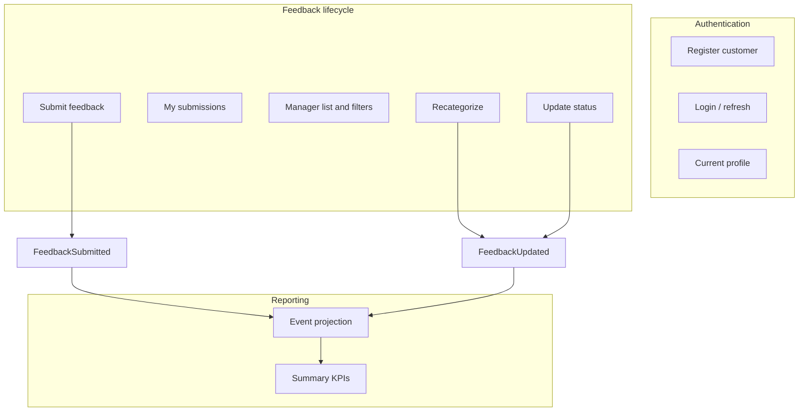
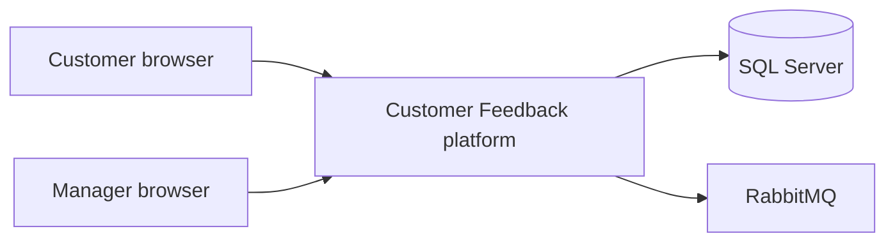
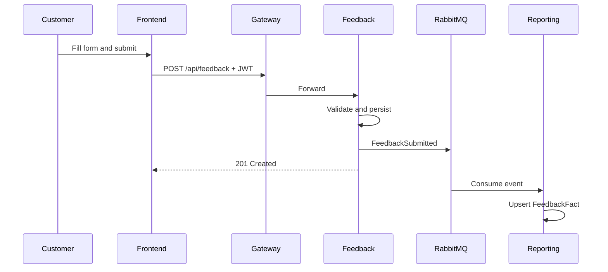
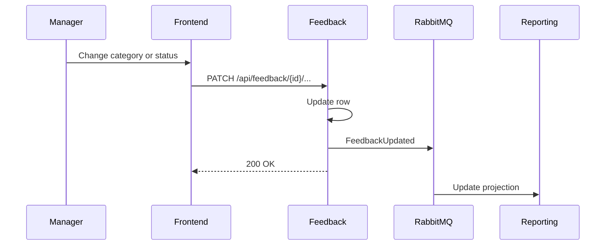
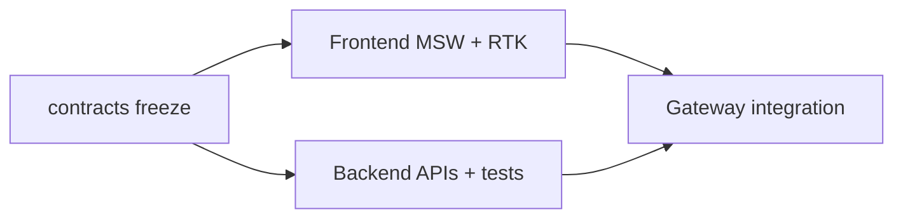

# High Level Design (HLD) — Customer Feedback

## 1. Purpose and scope

### 1.1 Purpose

Enable **store managers** to collect **customer feedback**, **categorize** submissions, and view **satisfaction trends** on a landing-page style dashboard. **Customers** can self-register, sign in, and submit structured feedback about store visits.

### 1.2 In scope (v1)

- Customer registration and authentication
- Feedback submission form (ratings, NPS, category, comments, optional anonymity)
- Manager feedback list with filters, recategorization, and status workflow
- Reporting summary (counts, averages, category breakdown, simple trend)
- Microservices backend (.NET 10), React 19 frontend, API gateway, RabbitMQ async integration
- Contract-first development (OpenAPI + event schemas)

### 1.3 Out of scope (v1)

- Multi-level store/region organization
- Email/SMS notifications
- AI-based categorization
- Real-time updates (SignalR)
- Production cloud landing zone (beyond docker-compose)

## 2. Stakeholders and actors

| Actor | Description |
| --- | --- |
| **Customer** | Registers via public API; submits and views own feedback |
| **Store manager** | Seeded user; views dashboard and manages all feedback for stores |
| **Developer (FE/BE)** | Implements against frozen contracts in parallel |

## 3. User stories (from requirements)

| ID | Story |
| --- | --- |
| US-1 | As a store manager, I want to collect and analyze customer feedback to improve operations and satisfaction |
| US-2 | As a customer, I want to submit feedback after a store visit |
| US-3 | As a store manager, I want a landing-page summary of satisfaction trends |
| US-4 | As a customer, I want to register and log in securely |

## 4. Functional decomposition

### 4.1 Capability matrix

| Capability | Customer | Store manager |
| --- | --- | --- |
| Register | Yes | No (seeded) |
| Login | Yes | Yes |
| Submit feedback | Yes | No |
| View own feedback | Yes | No |
| View all feedback | No | Yes |
| Change category/status | No | Yes |
| View report summary | No | Yes |

## 5. System context

External systems in v1: **none** (no payment, CRM, or email providers).

## 6. High-level component design

### 6.1 Frontend (presentation)

- **React 19** SPA with **React Router** for routes
- **Redux Toolkit + RTK Query** for server state and caching
- **MSW** for offline-first UI development against OpenAPI-shaped handlers
- Role-based route guards (`Customer` vs `StoreManager`)

### 6.2 API gateway (edge)

- **YARP** reverse proxy
- Routes: `/api/identity/*`, `/api/feedback/*`, `/api/reports/*`
- CORS for local frontend origin
- Does not own business data

### 6.3 Microservices

| Service | Bounded context | Persistence |
| --- | --- | --- |
| Identity | Users, credentials, JWT issuance, refresh rotation | `CF_Identity` |
| Feedback | Feedback aggregate, validation, publishing domain events | `CF_Feedback` |
| Reporting | Read model for analytics | `CF_Reporting` |

### 6.4 Shared kernel

`CustomerFeedback.BuildingBlocks`: JWT setup, Serilog, Problem Details middleware, pagination helpers, shared event DTOs, comment sanitization.

## 7. Data flow — submit feedback (happy path)

Manager dashboard reads **only** from Reporting (`GET /api/reports/summary`), not from Feedback.

## 8. Data flow — manager updates feedback

## 9. Non-functional requirements (mapping)

| NFR (from spec) | HLD decision |
| --- | --- |
| Microservices + REST | Gateway + three APIs |
| Async where needed | RabbitMQ between Feedback and Reporting |
| Logging | Serilog structured JSON per service |
| Validation | Client + FluentValidation; sanitized comments |
| Exception handling | Global handler → Problem Details |
| Unit testing | xUnit per service; WebApplicationFactory + in-memory DB / bus |
| Security | JWT + RBAC; manager not self-register |
| Configuration | JSON + env; encrypt secrets in deployment |
| Performance | Indexes on filter columns; reporting pre-aggregated via projection |

## 10. Parallel development model

**Exit criteria:** Full UX demo on MSW; backend tests pass without UI; switching off MSW and pointing at gateway completes integration.

## 11. Technology stack summary

| Layer | Technology |
| --- | --- |
| UI | React 19, TypeScript, Vite |
| Client state | Redux Toolkit, RTK Query |
| API contracts | OpenAPI 3.0 YAML |
| API host | ASP.NET Core 10 |
| ORM | Entity Framework Core 10 |
| DB | SQL Server (database per service) |
| Messaging | MassTransit + RabbitMQ |
| Gateway | YARP |
| Tests | xUnit, Microsoft.AspNetCore.Mvc.Testing |

## 12. Assumptions and constraints

- Small number of stores; `storeId` is a UUID (seeded store in [`contracts/stores.v1.json`](../contracts/stores.v1.json)).
- Clock skew for JWT validation: 30 seconds.
- Eventual consistency: dashboard may lag briefly after submit until consumer processes message.
- Same `Jwt:SigningKey` across Identity, Feedback, Reporting for token validation.

## 13. Document traceability

| HLD section | Detailed design |
| --- | --- |
| APIs and payloads | [LLD — REST API](lld.md#3-rest-api-design) |
| Tables and entities | [LLD — Data model](lld.md#4-data-model) |
| Deployment ports | [Architecture — Deployment](architecture.md#deployment-views) |
