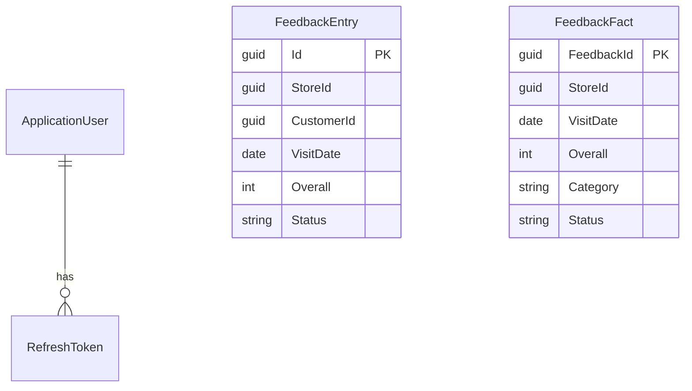
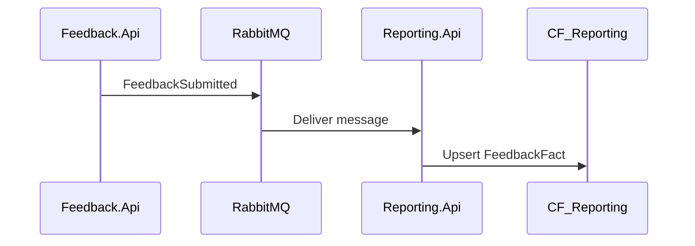

# Low Level Design (LLD) — Customer Feedback

This document specifies implementable detail: endpoints, entities, events, frontend modules, and key algorithms. It aligns with code under [`backend/`](../backend/), [`frontend/`](../frontend/), and [`contracts/`](../contracts/).

See also: [Architecture](architecture.md) | [HLD](hld.md)

## 1. Service endpoints and ports

| Service | Base path (on service) | Dev port | Health |
| --- | --- | --- | --- |
| Gateway | `/` (proxy only) | 5000 | `GET /health` |
| Identity | `/api/identity` | 5101 | `GET /health` |
| Feedback | `/api/feedback` | 5102 | `GET /health` |
| Reporting | `/api/reports` | 5103 | `GET /health` |

Gateway forwards paths **unchanged** to downstream clusters (see [`backend/gateway/Gateway/appsettings.json`](../backend/gateway/Gateway/appsettings.json)).

## 2. Authentication and authorization

### 2.1 JWT claims

| Claim | Usage |
| --- | --- |
| `sub` | User id (GUID) |
| `role` | `Customer` or `StoreManager` (multiple claims allowed) |
| `email`, `name` | Profile display |

Configuration keys: `Jwt:Issuer`, `Jwt:Audience`, `Jwt:SigningKey`, `Jwt:AccessTokenMinutes`, `Jwt:RefreshTokenDays`.

Implementation: [`JwtExtensions.cs`](../backend/shared/CustomerFeedback.BuildingBlocks/Auth/JwtExtensions.cs), [`TokenService.cs`](../backend/services/identity/Identity.Api/Services/TokenService.cs).

### 2.2 Refresh token storage

- Stored as **SHA-256 hash** in `RefreshTokens` table
- Rotation on refresh: old token revoked, new pair issued

### 2.3 Authorization policies

| Policy | Role | Used by |
| --- | --- | --- |
| `Customer` | `Customer` | Feedback POST, GET mine |
| `StoreManager` | `StoreManager` | Feedback GET list, PATCH; Reporting summary |

### 2.4 Seeded store manager

On startup, `IdentitySeeder` creates roles and optional manager from:

- `Seed:ManagerEmail`
- `Seed:ManagerPassword`
- `Seed:ManagerDisplayName`

## 3. REST API design

Canonical contracts: [`contracts/openapi/`](../contracts/openapi/). Error shape: [`contracts/errors/problem-details.md`](../contracts/errors/problem-details.md).

### 3.1 Identity

| Method | Path | Auth | Request | Response |
| --- | --- | --- | --- | --- |
| POST | `/api/identity/register` | None | `RegisterRequest` | 201 `UserProfile` |
| POST | `/api/identity/login` | None | `LoginRequest` | 200 `TokenResponse` |
| POST | `/api/identity/refresh` | None | `RefreshRequest` | 200 `TokenResponse` |
| GET | `/api/identity/me` | Bearer | — | 200 `UserProfile` |

### 3.2 Feedback

| Method | Path | Auth | Notes |
| --- | --- | --- | --- |
| POST | `/api/feedback` | Customer | Body: `CreateFeedbackRequest` → 201 `Feedback` |
| GET | `/api/feedback/mine` | Customer | Query: `page`, `pageSize` |
| GET | `/api/feedback` | StoreManager | Filters: `storeId`, `category`, `status`, `from`, `to` |
| PATCH | `/api/feedback/{id}/category` | StoreManager | Body: `{ "category": "Service" }` |
| PATCH | `/api/feedback/{id}/status` | StoreManager | Body: `{ "status": "Reviewed" }` |

Paged response: `PagedResult<T>` → `{ items, page, pageSize, totalCount }`.

### 3.3 Reporting

| Method | Path | Auth | Query | Response |
| --- | --- | --- | --- | --- |
| GET | `/api/reports/summary` | StoreManager | `storeId`, `from`, `to` | `ReportSummary` |

`ReportSummary` fields: `totalCount`, `averageOverall`, `averageNps`, `byCategory[]`, `trend[]`, `statusCounts { new, reviewed, actioned }`.

Computed in-memory from `FeedbackFacts` rows (v1); no cross-database queries.

## 4. Data model

### 4.1 Identity (`CF_Identity`)

**ApplicationUser** (extends `IdentityUser<Guid>`)

| Column | Type | Notes |
| --- | --- | --- |
| Id | GUID | PK |
| Email, UserName | string | Unique email |
| DisplayName | string | |
| PasswordHash | string | ASP.NET Identity |

**RefreshToken**

| Column | Type |
| --- | --- |
| Id | GUID |
| UserId | GUID FK |
| TokenHash | string (indexed) |
| ExpiresAt, CreatedAt, RevokedAt | datetimeoffset |

Roles: `Customer`, `StoreManager` (ASP.NET Identity roles).

### 4.2 Feedback (`CF_Feedback`)

**Feedback** table (`FeedbackEntry`)

| Column | Type | Index |
| --- | --- | --- |
| Id | GUID | PK |
| StoreId | GUID | Yes |
| CustomerId | GUID? | Yes (null if anonymous) |
| VisitDate | date | Yes |
| Overall, Cleanliness, Staff, WaitTime, ProductAvailability | int 1–5 | |
| NpsScore | int 0–10 | |
| Category | string(32) | Yes |
| Comments | string(2000)? | Sanitized |
| ContactEmail | string(256)? | |
| IsAnonymous | bool | |
| Status | string(32) | Yes (`New`, `Reviewed`, `Actioned`) |
| CreatedAt, UpdatedAt | datetimeoffset | |

DbContext: [`FeedbackDbContext.cs`](../backend/services/feedback/Feedback.Api/Data/FeedbackDbContext.cs).

### 4.3 Reporting (`CF_Reporting`)

**FeedbackFacts** (`FeedbackFact`)

| Column | Type | Notes |
| --- | --- | --- |
| FeedbackId | GUID | PK / natural key |
| StoreId | GUID | |
| VisitDate | date | Trend grouping |
| Overall, NpsScore | int | Averages |
| Category, Status | string | Breakdown |
| CreatedAt, UpdatedAt | datetimeoffset | |

DbContext: [`ReportingDbContext.cs`](../backend/services/reporting/Reporting.Api/Data/ReportingDbContext.cs).

### 4.4 ER diagram (logical)

Reporting does **not** FK to Identity or Feedback databases (integration via events only).

## 5. Messaging (RabbitMQ / MassTransit)

### 5.1 Message types

Shared records in [`CustomerFeedback.BuildingBlocks.Messaging`](../backend/shared/CustomerFeedback.BuildingBlocks/Messaging/):

**FeedbackSubmitted** — published after successful POST  
**FeedbackUpdated** — published after category or status PATCH

JSON schemas: [`contracts/events/`](../contracts/events/).

### 5.2 Publishers and consumers

| Component | Role |
| --- | --- |
| Feedback.Api | `IPublishEndpoint.Publish` on create/update |
| Reporting.Api | `FeedbackSubmittedConsumer`, `FeedbackUpdatedConsumer` |

Configuration:

- `RabbitMQ:Host`, `Username`, `Password`
- Tests / local without broker: `MassTransit:UseInMemory` or `UseInMemoryDatabase` triggers in-memory bus

Consumer logic (submitted): insert or upsert `FeedbackFact` by `FeedbackId` — [`FeedbackSubmittedConsumer.cs`](../backend/services/reporting/Reporting.Api/Consumers/FeedbackSubmittedConsumer.cs).

### 5.3 Sequence (consumer)

## 6. Validation and sanitization

### 6.1 Create feedback rules

FluentValidation: [`CreateFeedbackRequestValidator.cs`](../backend/services/feedback/Feedback.Api/Validation/CreateFeedbackRequestValidator.cs).

- Ratings 1–5; NPS 0–10
- `VisitDate` not in the future
- `Category` ∈ { Service, Product, Facilities, Other }
- If `IsAnonymous`, `ContactEmail` must be empty
- Comments max 2000 chars

### 6.2 Comment sanitization

[`CommentSanitizer`](../backend/shared/CustomerFeedback.BuildingBlocks/Text/CommentSanitizer.cs): HTML decode, strip tags, remove control chars, trim, cap length.

## 7. Error handling

[`ExceptionHandlingExtensions`](../backend/shared/CustomerFeedback.BuildingBlocks/Errors/ExceptionHandlingExtensions.cs):

| Exception | HTTP | Body |
| --- | --- | --- |
| `AppException` | status from exception | Problem Details + optional `errors` |
| `ValidationException` (FluentValidation) | 400 | Field errors (camelCase keys) |
| Other | 500 | Generic detail (detail exposed in Development) |

## 8. Frontend low-level design

### 8.1 Routes

| Path | Guard | Page component |
| --- | --- | --- |
| `/login` | Public | `LoginPage` |
| `/register` | Public | `RegisterPage` |
| `/feedback/new` | Customer | `FeedbackFormPage` |
| `/feedback/mine` | Customer | `MyFeedbackPage` |
| `/` | StoreManager | `ManagerDashboardPage` |
| `/manager/feedback` | StoreManager | `ManagerFeedbackPage` |

### 8.2 State

| Slice / API | Responsibility |
| --- | --- |
| `authSlice` | `accessToken`, `user`; refresh in `localStorage` key `cf_refresh_token` |
| `api` (RTK Query) | Endpoints mirroring OpenAPI paths under `/api/...` |

Base URL: `import.meta.env.VITE_API_BASE_URL` (empty → same origin / Vite proxy).

### 8.3 MSW mocks

- [`frontend/src/mocks/handlers.ts`](../frontend/src/mocks/handlers.ts) — handlers per route
- Enabled when `VITE_USE_MSW !== 'false'`
- Manager demo login: `manager@store.local`

### 8.4 RTK Query tags

- `Feedback` — invalidated on create, patch
- `Report` — invalidated on feedback changes (manager summary refresh)

## 9. Shared building blocks

| Module | Types / APIs |
| --- | --- |
| `Auth` | `AddJwtBearerAuth` |
| `Errors` | `AppException`, `UseProblemDetailsExceptionHandler` |
| `Logging` | `AddSerilogLogging`, `UseCustomerFeedbackPipeline` |
| `Pagination` | `Paging.Normalize`, `PagedResult<T>` |
| `Validation` | `RequestValidator.EnsureValidAsync` |
| `Messaging` | Event records |
| `Text` | `CommentSanitizer` |

## 10. Testing (LLD)

| Project | Approach |
| --- | --- |
| Identity.Api.Tests | `WebApplicationFactory`, in-memory EF, register + login |
| Feedback.Api.Tests | JWT minted in test, POST feedback |
| Reporting.Api.Tests | Publish `FeedbackSubmitted` via MassTransit in-memory, GET summary |

Run: `dotnet test backend/CustomerFeedback.slnx`

## 11. Configuration reference

| Key | Service | Purpose |
| --- | --- | --- |
| `ConnectionStrings:Default` | Identity, Feedback, Reporting | SQL Server |
| `Jwt:SigningKey` | All APIs validating tokens | HMAC key |
| `RabbitMQ:Host` | Feedback, Reporting | Broker hostname |
| `UseInMemoryDatabase` | APIs | Test / local EF in-memory |
| `MassTransit:UseInMemory` | Feedback, Reporting | In-memory bus |
| `Seed:Manager*` | Identity | Bootstrap manager |

## 12. Default store

From [`contracts/stores.v1.json`](../contracts/stores.v1.json):

- Store id: `11111111-1111-1111-1111-111111111111`
- Name: Downtown Store

Frontend constant: `DEFAULT_STORE_ID` in [`frontend/src/types/api.ts`](../frontend/src/types/api.ts).

## 13. Known v1 limitations (implementation)

- Database schema applied via `EnsureCreated` at startup (migrations can be introduced per service later).
- Gateway does not validate JWT (services enforce authorization).
- Reporting summary aggregates all matching facts in memory (acceptable for v1 volume).
- Refresh token in browser `localStorage` (not httpOnly cookies).
