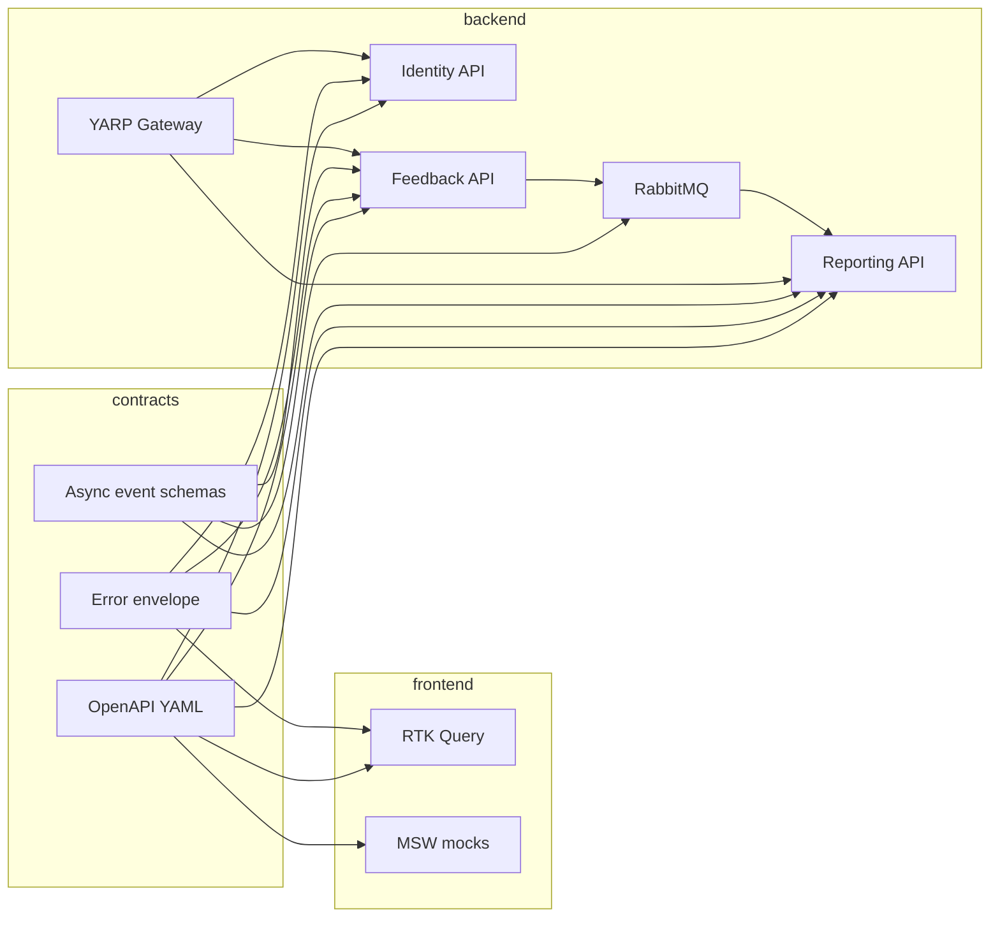

# Frontend / Backend Parallel Development Plan

Customer Feedback is a store-manager product: collect customer feedback, categorize it, and show satisfaction trends. This document is the shared v1 plan so **React 19** and **.NET 10** teams can work in parallel against frozen contracts.

Source: [Docs/feedback form.docx](Docs/feedback%20form.docx).

## Locked decisions

| Topic | Choice |
| --- | --- |
| Architecture | Microservices: YARP API Gateway + Identity + Feedback + Reporting |
| Auth | JWT + RBAC. Customers self-register. Store managers are **seeded/invited** (not public signup). |
| Database | SQL Server, **database per service** |
| Messaging | MassTransit + RabbitMQ (`FeedbackSubmitted`, `FeedbackUpdated`) |
| Frontend | React 19, Vite, TypeScript, React Router, Redux Toolkit + RTK Query, MSW mocks |
| Backend | .NET 10, EF Core, FluentValidation, Serilog, xUnit, Problem Details |
| Parallel rule | Frontend never waits on live APIs. Backend never waits on UI. Both implement the same versioned OpenAPI, error envelope, and event schemas. |

## Parallel-work rule

1. Freeze contracts first (`contracts/` OpenAPI, events, Problem Details).
2. Frontend implements UI + RTK Query against **MSW** (OpenAPI-shaped mocks).
3. Backend implements services + xUnit against the same OpenAPI.
4. Integration is a **config switch** (Vite proxy / RTK `baseUrl` → Gateway; MSW off), not a rewrite.



**Definition of done for parallel work:** FE can demo the full UX on MSW; BE can pass contract tests without the FE.

## Proposed repo layout (monorepo)

```
plan.md
contracts/
  openapi/
    identity.v1.yaml
    feedback.v1.yaml
    reporting.v1.yaml
  events/
    feedback-submitted.v1.json
    feedback-updated.v1.json
  errors/
    problem-details.md
frontend/                      # React 19 + Vite + RTK
backend/
  gateway/                     # YARP
  services/identity            # Domain, Application, Infrastructure, Api
  services/feedback            # Domain, Application, Infrastructure, Api
  services/reporting           # Domain, Application, Infrastructure, Api
  shared/                      # logging, auth, errors, pagination
docker-compose.yml             # SQL Server, RabbitMQ, services, frontend
```

Do not scaffold apps until implementation is requested. Contracts land before API hosts or feature UI.

## Domain (v1)

The Word spec does not define form fields. Both teams use this schema.

### Feedback submission

| Field | Type | Rules |
| --- | --- | --- |
| `storeId` | UUID | Required |
| `visitDate` | date | Required, not in the future |
| `overall` | int | Required, 1–5 |
| `cleanliness` | int | Required, 1–5 |
| `staff` | int | Required, 1–5 |
| `waitTime` | int | Required, 1–5 |
| `productAvailability` | int | Required, 1–5 |
| `npsScore` | int | Required, 0–10 |
| `category` | enum | `Service` \| `Product` \| `Facilities` \| `Other` |
| `comments` | string | Optional, max 2000 chars, sanitized |
| `contactEmail` | string | Optional email; omitted when `isAnonymous` is true |
| `isAnonymous` | bool | Default false |

Server-owned fields: `id`, `customerId` (null if anonymous), `status` (`New` \| `Reviewed` \| `Actioned`), `createdAt`, `updatedAt`.

### Roles

| Role | How obtained | Capabilities |
| --- | --- | --- |
| `Customer` | Public register + login | Submit feedback, list own submissions |
| `StoreManager` | Seed / invite only | Dashboard summary, list/filter all feedback, recategorize, change status |

v1 assumes a small set of stores (seeded). Multi-store org hierarchy is out of scope.

## Service and API table

Gateway base URL: `https://localhost:5000` (dev). Public paths:

| Gateway path | Service | Auth | Description |
| --- | --- | --- | --- |
| `POST /api/identity/register` | Identity | Anonymous | Customer self-registration |
| `POST /api/identity/login` | Identity | Anonymous | Returns access + refresh JWT |
| `POST /api/identity/refresh` | Identity | Refresh token | New access token |
| `GET /api/identity/me` | Identity | JWT | Current user + roles |
| `POST /api/feedback` | Feedback | `Customer` | Create submission |
| `GET /api/feedback/mine` | Feedback | `Customer` | Paged own submissions |
| `GET /api/feedback` | Feedback | `StoreManager` | Paged list: filter `storeId`, `category`, `status`, date range |
| `PATCH /api/feedback/{id}/category` | Feedback | `StoreManager` | Recategorize |
| `PATCH /api/feedback/{id}/status` | Feedback | `StoreManager` | `New` → `Reviewed` → `Actioned` |
| `GET /api/reports/summary` | Reporting | `StoreManager` | Landing-page KPIs |

### Reporting summary shape

`GET /api/reports/summary?storeId=&from=&to=`

- `totalCount`, `averageOverall`, `averageNps`
- `byCategory[]` (`category`, `count`, `averageOverall`)
- `trend[]` (period `yyyy-MM-dd` or week bucket, `count`, `averageOverall`, `averageNps`)
- `statusCounts` (`new`, `reviewed`, `actioned`)

Reporting is a **read model**. Feedback publishes events; Reporting projects into its own SQL tables. Feedback stays write-optimized.

### Async events

**`FeedbackSubmitted` v1**

```json
{
  "feedbackId": "uuid",
  "storeId": "uuid",
  "customerId": "uuid|null",
  "visitDate": "date",
  "overall": 1,
  "cleanliness": 1,
  "staff": 1,
  "waitTime": 1,
  "productAvailability": 1,
  "npsScore": 0,
  "category": "Service",
  "status": "New",
  "createdAt": "iso-8601"
}
```

**`FeedbackUpdated` v1:** `feedbackId`, `category`, `status`, `updatedAt`.

### Shared errors

RFC 7807 Problem Details for all APIs:

```json
{
  "type": "https://httpstatuses.com/400",
  "title": "Validation failed",
  "status": 400,
  "detail": "One or more fields are invalid.",
  "traceId": "00-...",
  "errors": {
    "overall": ["Must be between 1 and 5."]
  }
}
```

Use this envelope for 400, 401, 403, 404, and 500. Do not return ad-hoc `{ "message": "..." }` objects.

### Pagination

List endpoints: `page` (1-based), `pageSize` (default 20, max 100). Response: `{ "items": [], "page": 1, "pageSize": 20, "totalCount": 0 }`.

## Frontend (React 19 + RTK)

### Stack

- Vite + TypeScript + React 19
- React Router
- Redux Toolkit + **RTK Query**
- Types from OpenAPI via `openapi-typescript`
- **MSW** handlers matching OpenAPI so UI proceeds without backend
- Client validation aligned with FluentValidation rules documented in `contracts`

### Routes

| Path | Role | Page |
| --- | --- | --- |
| `/register` | Anonymous | Customer registration |
| `/login` | Anonymous | Login |
| `/feedback/new` | `Customer` | Submit feedback |
| `/feedback/mine` | `Customer` | My submissions |
| `/` | `StoreManager` | Landing summary (reporting) |
| `/manager/feedback` | `StoreManager` | List, recategorize, status |

Route guards by role. Unauthenticated users go to `/login`.

### Auth (v1)

Access token in memory (Redux). Refresh token: document **temporary** `localStorage` for v1; replace with httpOnly cookie before production. RTK Query `baseQuery` attaches `Authorization: Bearer` and maps Problem Details to UI errors.

### Frontend track (can start after contract freeze)

1. Scaffold Vite app, router, store, layout.
2. MSW + fixture data for identity, feedback, reporting.
3. Register / login / `me`.
4. Feedback form + my list.
5. Manager dashboard (summary cards + trend).
6. Manager feedback table (filters, category, status).
7. Wire RTK Query to Gateway; disable MSW for integration.

## Backend (.NET 10)

### Stack per service

- ASP.NET Core minimal APIs (.NET 10), one host project per service
- Clean Architecture projects: Domain, Application, Infrastructure, Api
- EF Core + SQL Server in Infrastructure; schema applied with `EnsureCreated` in v1
- Serilog structured JSON (`INFO`, `DEBUG`, `ERROR`) + correlation / `traceId`
- FluentValidation on commands
- Global exception middleware → Problem Details
- JWT bearer; same signing configuration as Gateway
- xUnit + NSubstitute (or Moq) + Testcontainers (SQL Server, RabbitMQ)

### Gateway (YARP)

- Routes `/api/identity/*`, `/api/feedback/*`, `/api/reports/*`
- Validates JWT (except register/login/refresh)
- Forwards `sub` and roles to downstream services
- Prefer YARP over Ocelot on .NET 10

### Identity

- Register customer (`Customer` role only)
- Login / refresh
- `GET /me`
- Seed at least one store manager (user-secrets / env: email + password; never commit secrets)
- Hash passwords (ASP.NET Identity or equivalent)

### Feedback

- CRUD-style submit + queries as in the API table
- Strong validation + input sanitization on `comments`
- Publish `FeedbackSubmitted` / `FeedbackUpdated` to RabbitMQ
- Indexes: `storeId`, `visitDate`, `category`, `status`, `customerId`

### Reporting

- Subscribe to events; upsert projection tables
- `GET /reports/summary` from projections only (no cross-DB queries to Feedback)

### Configuration and security

- `appsettings.json` + environment variables + user-secrets locally
- Encrypt/protect sensitive values in deployed environments
- Never commit connection strings, JWT signing keys, or seed passwords
- Role-based authorization on every non-anonymous endpoint

### Backend track (can start after contract freeze)

1. Shared libraries: Serilog, Problem Details, JWT, pagination.
2. Identity API + seed manager + xUnit.
3. YARP Gateway JWT forwarding.
4. Feedback API + events + xUnit.
5. Reporting consumer + summary API + xUnit.
6. docker-compose: SQL Server, RabbitMQ, three DBs, four processes.

## docker-compose sketch (implementation phase)

```yaml
services:
  sqlserver:
    image: mcr.microsoft.com/mssql/server:2022-latest
    environment:
      ACCEPT_EULA: "Y"
      MSSQL_SA_PASSWORD: "${MSSQL_SA_PASSWORD}"
  rabbitmq:
    image: rabbitmq:3-management
  identity:
    build: ./backend/services/identity
    environment:
      ConnectionStrings__Default: "Server=sqlserver;Database=CF_Identity;..."
      Jwt__SigningKey: "${JWT_SIGNING_KEY}"
  feedback:
    build: ./backend/services/feedback
  reporting:
    build: ./backend/services/reporting
  gateway:
    build: ./backend/gateway
    ports: ["5000:8080"]
  frontend:
    build: ./frontend
    ports: ["5173:80"]
```

Local FE without compose: Vite proxy `/api` → `https://localhost:5000`. MSW used until Gateway is up.

## Milestones

| # | Name | Both / FE / BE | Exit criteria |
| --- | --- | --- | --- |
| 1 | Contract freeze | Both | OpenAPI, events, Problem Details, field list, roles in `contracts/` |
| 2 | Frontend track | FE | Full UX demoable on MSW |
| 3 | Backend track | BE | Identity → Gateway → Feedback → Reporting; tests per service |
| 4 | Integration | Both | FE against Gateway; OpenAPI diff in CI; no contract drift |
| 5 | Hardening | Both | Correlation IDs, indexes, basic load test (k6 or NBomber), analyzers (Sonar-style) |

No feature UI or API hosts until milestone 1 files exist.

## Technical expectations (from spec)

| Aspect | How v1 meets it |
| --- | --- |
| Microservices | Independent Identity, Feedback, Reporting; REST sync; RabbitMQ async |
| Logging | Serilog levels INFO / DEBUG / ERROR; structured JSON |
| Performance | Indexes on filter columns; basic load test in milestone 5 |
| Validation | Client (schema) + server (FluentValidation); sanitize comments |
| Exception handling | Global handlers; Problem Details |
| Unit testing | xUnit + mocks/Testcontainers; high coverage on domain/handlers |
| Security | JWT, RBAC, secrets in env, no public manager signup |
| Code quality | Shared conventions; analyzers; design by service boundaries |
| Configuration | JSON + env + user-secrets; no secrets in git |

## Out of scope (v1)

- Multi-store organization hierarchy
- Email / SMS
- AI auto-categorization
- SignalR realtime
- Production AKS / Azure layout beyond docker-compose
- httpOnly cookie auth (called out as post-v1 hardening)

## What to implement next

This file is the plan only. When implementation starts: add `contracts/` first, then run FE and BE tracks in parallel as above.
